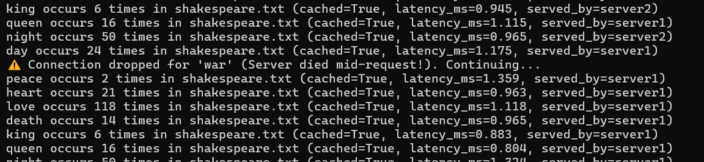
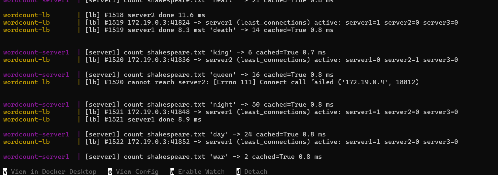
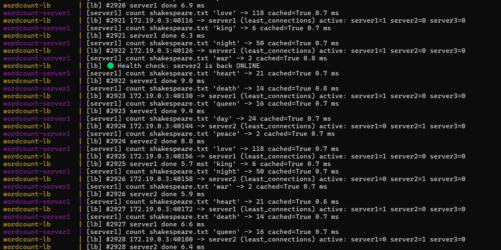

# Distributed Word Count Service: Scalability, Load Balancing & Fault Tolerance

A distributed Word Count Service developed for the **Architecture of Distributed Systems** course at Eindhoven University of Technology (TU/e). The system processes keyword occurrence requests across text files, uses Redis for caching, and distributes requests across replicated servers using a custom TCP load balancer.

## Table of Contents

- [Project Overview](#project-overview)
- [Phase 1: Architectural Model](#phase-1-architectural-model)
- [Phase 2: Core Service & Virtualization](#phase-2-core-service--virtualization)
- [Phase 3: Scalability & Load Balancing](#phase-3-scalability--load-balancing)
- [Phase 4: Fault Tolerance & Health Monitoring](#phase-4-fault-tolerance--health-monitoring)
- [Getting Started](#getting-started)
- [Testing Fault Tolerance](#testing-fault-tolerance)
- [Fault Tolerance Evidence](#fault-tolerance-evidence)
- [Makefile Quick Reference](#makefile-quick-reference)
- [Benchmarking & Report Generation](#benchmarking--report-generation)
- [Technologies Used](#technologies-used)

## Project Overview

The project explores the design and implementation of a distributed service, progressing from a basic client-server architecture to a replicated system with load balancing, performance evaluation, health monitoring, and fault tolerance.

### Key Features

- Distributed word-count requests across multiple backend servers.
- Redis-based caching for frequently requested results.
- Docker-based deployment and service orchestration.
- Custom asynchronous TCP load balancer.
- Least Connections and Least Response Time (LRT) load-balancing algorithms.
- Automated backend health checks.
- Failure detection, traffic rerouting, and automatic server reintegration.
- Performance evaluation using average and 99th-percentile (p99) latency.

## Phase 1: Architectural Model

### Architectural Style

The system follows a **client-server architecture**. Clients submit requests containing a file identifier and keyword, and the service returns the corresponding word frequency.

### Requirements

**Functional requirements**

- Return word frequencies for a specified file and keyword.
- Cache query results in Redis.
- Handle requests from multiple clients.

**Non-functional requirements**

- Target a client response time below four seconds.
- Support concurrent requests.
- Maintain service availability when a backend server fails.

### Stakeholders

- **Developers:** Implement and maintain the service.
- **Site Reliability Engineers (SREs):** Configure resources, monitor performance, and maintain service availability.

### Architectural Trade-offs

**Publish-subscribe architecture**

Publish-subscribe was not selected because the workload consists primarily of requests for static files. A push-based notification mechanism would add complexity without providing significant benefits for this request-response workload.

**Peer-to-peer (P2P) architecture**

A P2P design could distribute requests and cached data among peers. However, it would introduce additional complexity involving peer discovery, data availability, replication, and failure management.

## Phase 2: Core Service & Virtualization

### Virtualization and Orchestration

The service components run in Docker containers and are managed through Docker Compose. This simplifies deployment and provides a reproducible environment for testing.

### RPC Communication

Python's `rpyc` library is used for remote procedure calls between the client and the word-count service.

### Performance Evaluation

Performance is evaluated under different request loads using:

- **Average latency:** The average time required to process a request.
- **p99 latency:** The latency below which 99% of measured requests complete.
- **Request concurrency:** The effect of concurrent requests on service performance.

## Phase 3: Scalability & Load Balancing

### Server Replication

The service is scaled from one server to three active backend replicas:

- `server1`
- `server2`
- `server3`

Replication allows incoming requests to be distributed across multiple instances instead of relying on a single server.

### Custom TCP Load Balancer

A custom load balancer is implemented using Python's `asyncio` library. It forwards TCP byte streams between clients and backend servers, allowing the client to communicate through a single entry point.

### Load-Balancing Algorithms

**1. Least Connections**

Routes new connections to the available backend server with the fewest active connections. This helps distribute traffic when connection durations differ.

**2. Least Response Time (LRT)**

Uses an exponentially weighted moving average (EWMA) of observed response times to estimate server responsiveness. An aging mechanism allows the algorithm to adapt to changing performance.

### Performance Comparison

The benchmarking scripts are used to compare latency under different configurations and load-balancing strategies. The results can be used to evaluate average response time, p99 tail latency, and the effects of server replication.

## Phase 4: Fault Tolerance & Health Monitoring

### Background Health Monitoring

The load balancer periodically checks backend server availability using asynchronous TCP connection probes.

### Failure Detection and Traffic Rerouting

When a backend server becomes unavailable, the health monitor marks it offline so that new requests can be routed to healthy replicas.

### Automatic Recovery

When the failed server becomes reachable again, the health monitor detects its recovery and reintegrates it into the active routing pool.

This mechanism allows the service to continue handling requests during backend failures, subject to the availability of healthy replicas and the behaviour of in-flight connections.

## Getting Started

### Prerequisites

- Docker Desktop or Docker Engine.
- Docker Compose.
- Python and the project's required dependencies for local benchmarking.
- GNU Make, if you want to use the Makefile shortcuts.

### 1. Start the Full Cluster

From the repository root, build and start the Redis cache, three server replicas, and the load balancer:

```bash
docker compose up -d --build --wait
```

### 2. Send Parallel Requests

Run nine parallel requests through the load balancer:

```bash
docker compose run --rm --no-deps client wordcount-client --file shakespeare.txt --keyword "love,death,king,queen,night,day,war,peace,heart" --repeat 9 --parallel
```

This test can be used to observe request distribution and verify that the service returns word-count results.

### 3. Monitor the Load Balancer

Open a separate terminal and follow the load balancer logs:

```bash
docker compose logs -f loadbalancer
```

Keep this terminal open while running the fault-tolerance test.

## Testing Fault Tolerance

This test demonstrates backend failure detection, request rerouting, and automatic recovery.

### Step 1: Start a Continuous Request Stream

In a second terminal, run repeated requests:

```bash
docker compose run --rm --no-deps client wordcount-client --file shakespeare.txt --keyword "love,death,king,queen,night,day,war,peace,heart" --repeat 1000
```

### Step 2: Simulate a Server Failure

In a third terminal, stop one of the backend servers:

```bash
docker kill wordcount-server2
```

Observe the load balancer logs for a failed health check and inspect the client output for connection drops or recovery messages.

The load balancer should stop routing new requests to the failed server once it has detected the failure.

### Step 3: Restore the Server

Restart the stopped container:

```bash
docker start wordcount-server2
```

Observe the logs for a successful health check and the server's reintegration into the routing pool.

### Step 4: Verify Recovery

Check that requests continue to complete and that the recovered server becomes eligible to receive traffic again.

Actual detection and recovery times depend on the health-check interval, connection timeouts, and the handling of in-flight requests.

## Fault Tolerance Evidence

The following screenshots document client-side resilience and load-balancer health monitoring during server failure and recovery.

### 1. Client-Side Resilience

The screenshots below show client behaviour during the fault-tolerance test, including connection interruptions and recovery.



*Client-side behaviour during backend failure.*


*Additional client-side evidence during failure and recovery.*

### 2. Load Balancer Detection and Recovery

The screenshots below show the load balancer's health monitoring and backend recovery behaviour.



*Load-balancer health-check and failure-detection evidence.*



*Additional load-balancer evidence during recovery.*

## Makefile Quick Reference

If GNU Make is installed and the corresponding targets are defined in the project's Makefile, the following commands can be used:

| Command | Description |
|---|---|
| `make up` | Start Redis, the three server replicas, and the load balancer. |
| `make demo` | Run the parallel-request demonstration. |
| `make logs` | Follow the load balancer and server logs. |
| `make lb-lrt` | Switch to the Least Response Time algorithm. |
| `make benchmark-phase3` | Run the Phase 3 benchmarking workflow. |

Example:

```bash
make up
```

Refer to the project's `Makefile` for the exact behaviour of each target.

## Benchmarking & Report Generation

The project includes scripts for automated performance evaluation and the generation of figures and LaTeX tables for the final IEEE report.

### 1. Run the Benchmark Script

On Windows, use the Python executable from the project's virtual environment:

```powershell
.\.venv\Scripts\python.exe scripts\benchmark.py
```

### 2. Generate Phase 3 Figures

```powershell
.\.venv\Scripts\python.exe scripts\plot_phase3.py --report-dir ../ADS-Project
```

The scripts may require the cluster to be running and the required Python dependencies to be installed. Ensure that the output directory exists if required by the scripts.

## Technologies Used

| Technology | Purpose |
|---|---|
| Python | Core service, client, and load-balancer implementation |
| RPyC | Remote procedure call communication |
| Asyncio | Asynchronous TCP connection handling |
| TCP | Client-to-load-balancer and load-balancer-to-server communication |
| Redis | In-memory caching |
| Docker | Containerization |
| Docker Compose | Multi-container deployment and orchestration |
| EWMA | Response-time estimation for load balancing |
| GNU Make | Common development and benchmarking shortcuts |
| LaTeX | Technical report preparation |

## Project Objectives

This project demonstrates the practical application of distributed systems concepts, including architectural design, virtualization, replication, load balancing, performance evaluation, and fault tolerance.

By combining multiple backend replicas with dynamic request routing and health monitoring, the system explores how a distributed service can improve scalability and maintain availability in the presence of backend failures.

